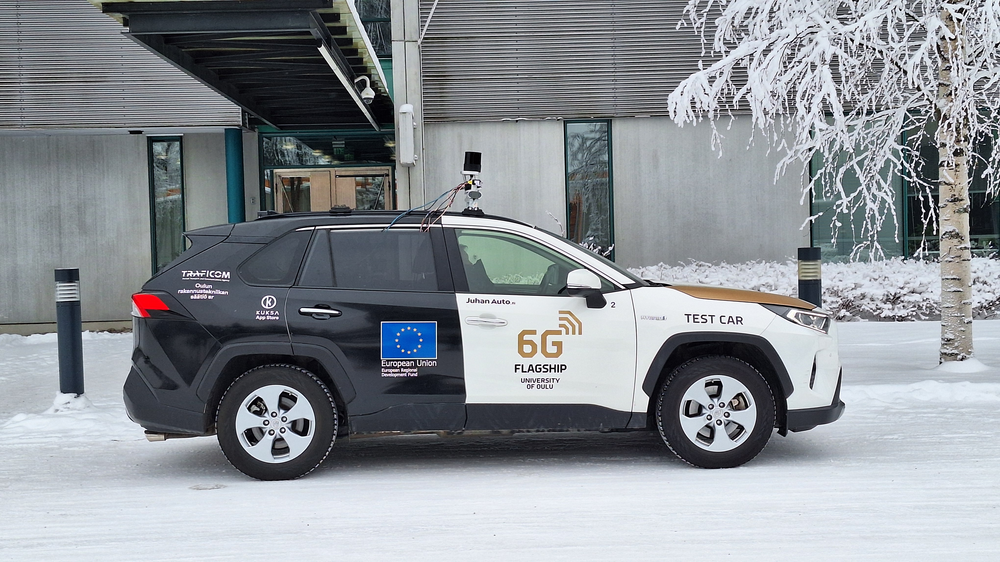
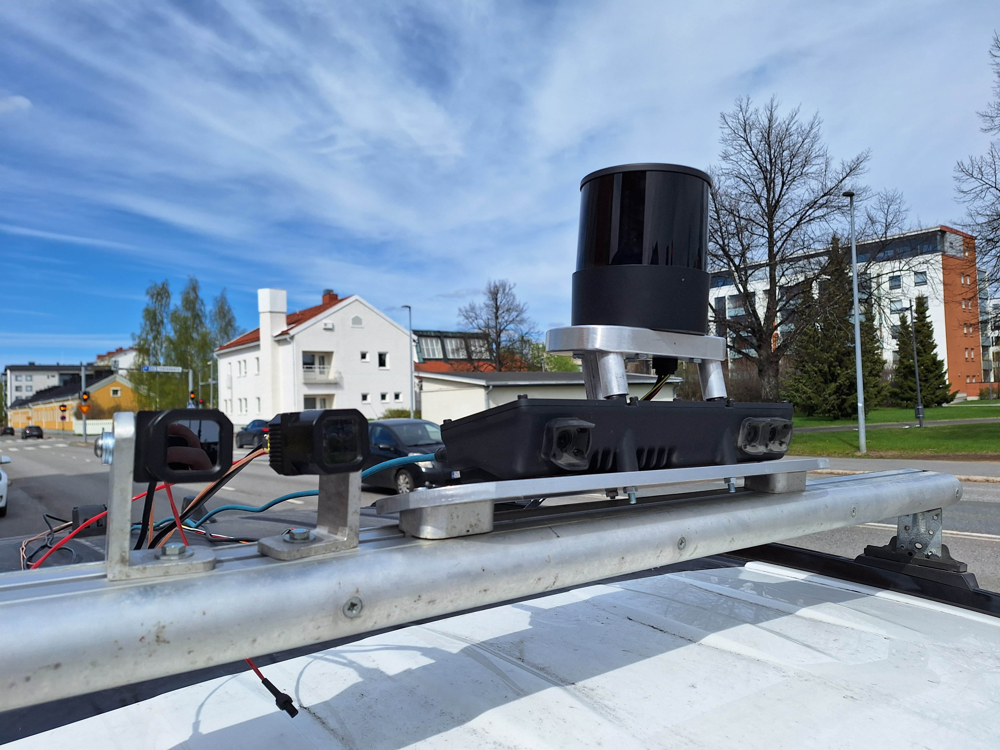
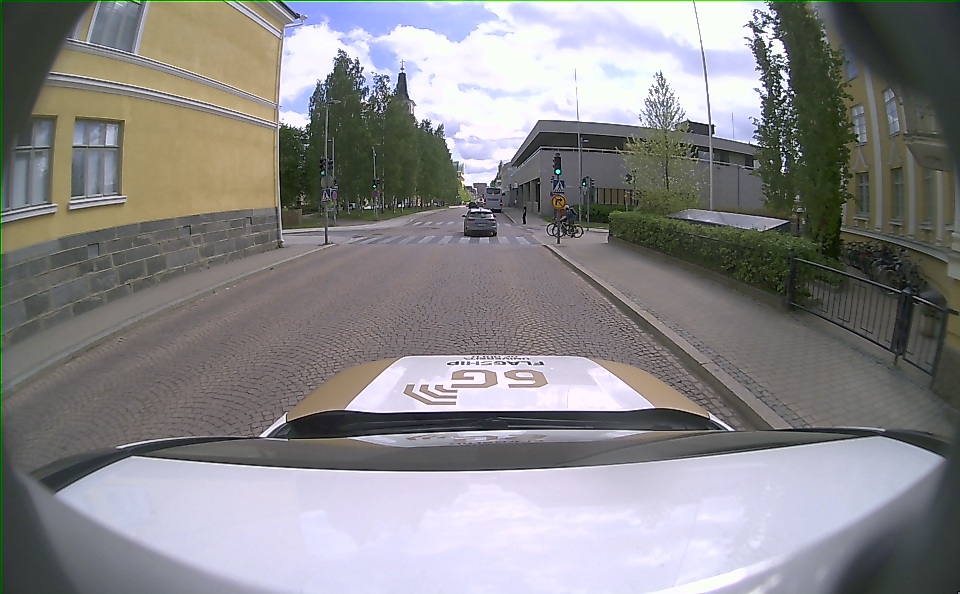
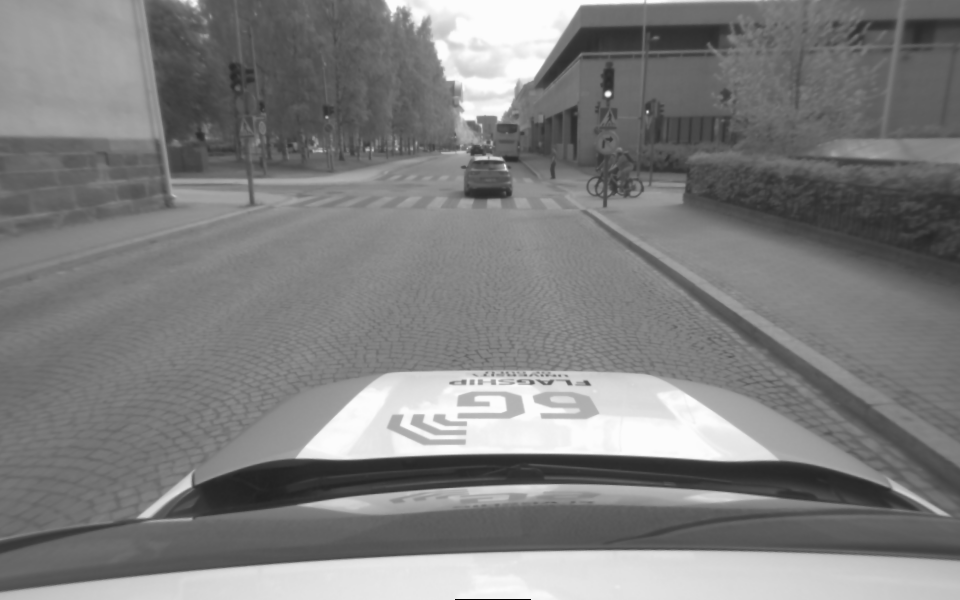
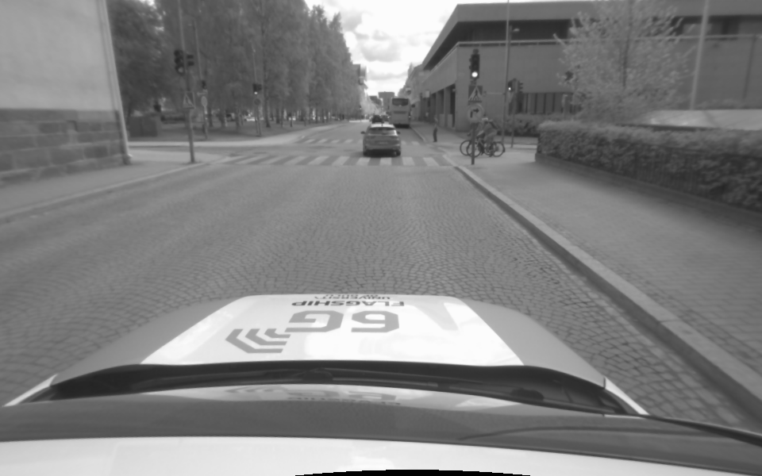
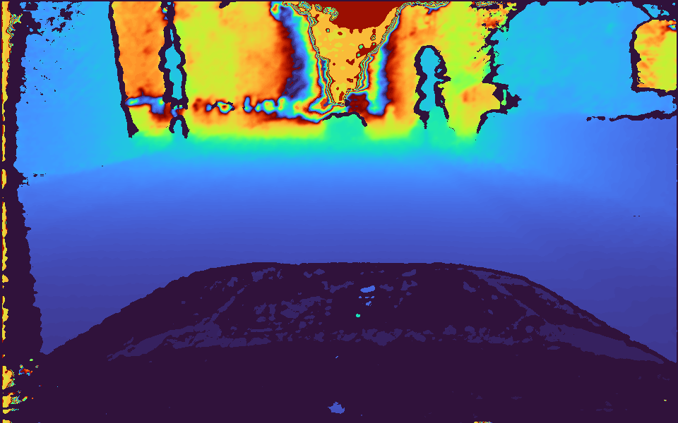
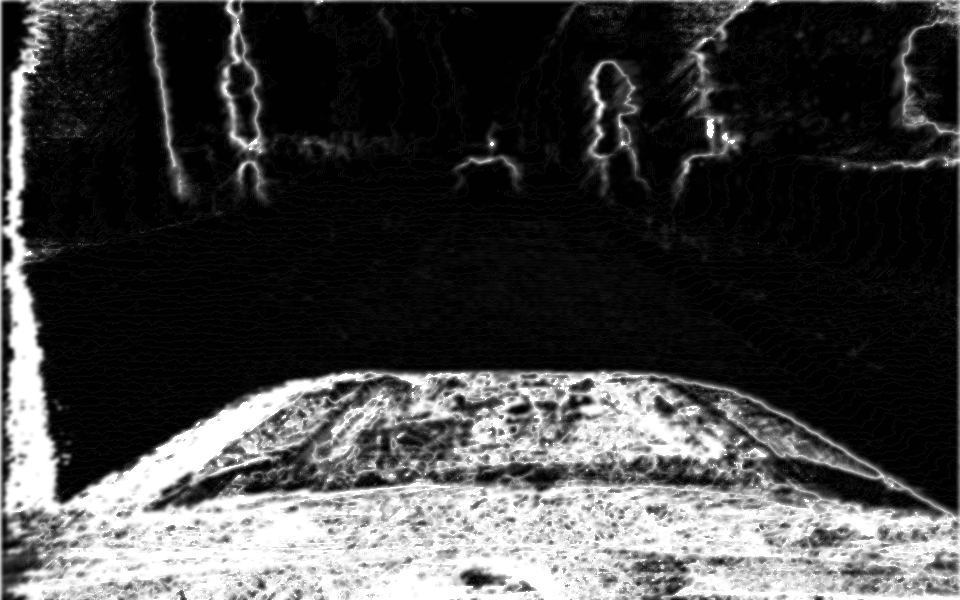
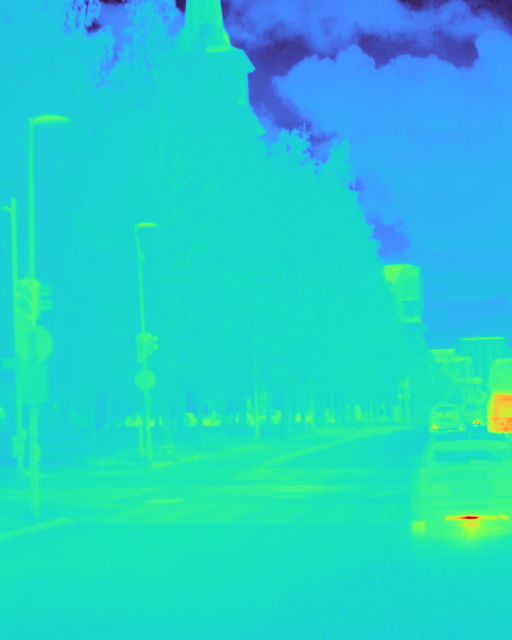
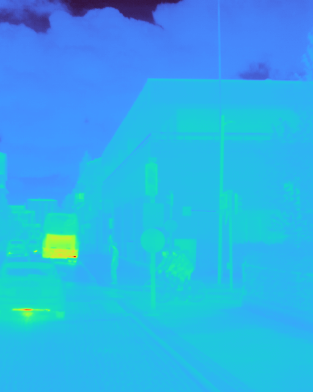
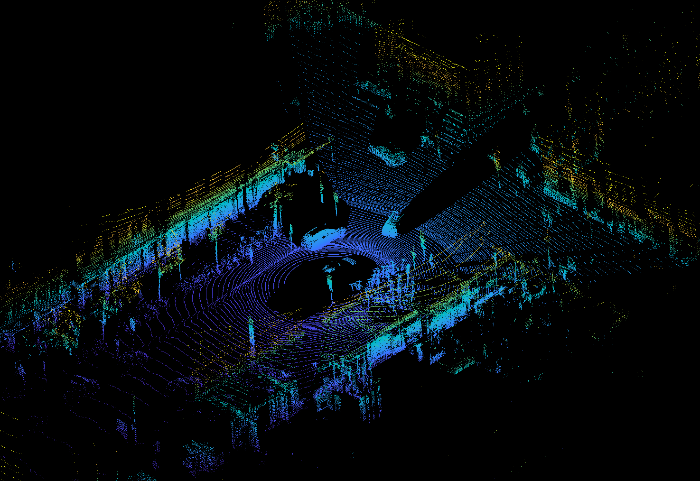

This page is the data specification for the Tupos dataset. The dataset includes IMU data from two different devices ([Hesai OT-128 Lidar](https://www.hesaitech.com/product/ot128/) & [Carnegie Multisense S27 Stereocamera](https://shop.carnegierobotics.com/products/multisense-s27), as well as Stereocamera camera pictures, Lidar pointcloud files, GPS and CAN bus data. In addition, weather data is provided from nearest stations.

This dataset continues the work started with the [WASA dataset](https://m3s-kuura.github.io/wasa-dataset/) and described in the "Towards Collecting Large-Scale Vehicular Sensor Data for Open Access" paper, published in the 12th International Workshop on Autonomous Systems and Software Architecture (WASA) 2026. Both datasets are free to be used under the Creative Commons CC BY 4.0 [license](https://creativecommons.org/licenses/by/4.0/deed.en). When using the data, you must give an attribution to the following paper and provide a link to the dataset:

_B. Kämä, O. Timonen, N. Stafford, J. Lotvonen, O. Kalliokoski, A. Kanerva, P. Rathnayake, S. Gamage, A. Vuorinen, S. Ariram, E. Gilman & E. Peltonen.
Towards Collecting Large-Scale Vehicular Sensor Data for Open Access. IEEE 23rd International Conference on Software Architecture Companion (ICSA-C). Amsterdam, Netherlands. 2026_

[Link to the preprint](https://www.researchgate.net/publication/406808081_Towards_Collecting_Large-Scale_Vehicular_Sensor_Data_for_Open_Access) and [final publication](https://ieeexplore.ieee.org/document/11641223)

For further enqueries and questions about the data or paper, please contact benjamin.kama or ella.peltonen at oulu.fi



## How the Dataset was Collected

The dataset was collected by driving in areas around Oulu, Finland while having sensors installed on the roof of the car, except for the Bosch XDK 110 which is located inside the car between front seats. Sensor data was collected and recorded via ROS2 on on-board computer. Recorded data includes stereo camera images, lidar pointcloud, the car's CAN bus data and GPS information along with IMU data from three devices.

## Included datasets

All datasets were collected in similar weather conditions: sunny, ~10°C in October around Oulu region.

| Road quality | Dataset name | Driving speed in km/h |
| -- | -- | -- |
| Bumpy gravel | imu_bumpy_gravel_processed | ~20 |
| Gravel | imu_soratie_processed | 30-50 |
| City center | imu_city_center_processed | 20-40 |
| Residential area | imu_rajakyla_processed | 40 |
| Paved road (60kmh) | imu_60kmh_processed | 60 |
| Paved road (Alakylantie) | imu_alakylantie_80kmh_processed | 80 |
| Highway | imu_highway_processed | 100 |


## Computer and software setup

The computer inside the car is a [NVIDIA Jetson AGX Orin Developer Kit](https://www.nvidia.com/en-us/autonomous-machines/embedded-systems/jetson-orin/) on Ubuntu 24.04 running ROS2 nodes in Docker containers. The nodes include sensor drivers, and a recorder to write the messages on an SSD in the form of [.mcap](https://mcap.dev/) files. [The source code for our setup is publicly available on github](https://github.com/M3S-Kuura/ros2-device-control). The source codes for the [.mcap processor](https://github.com/M3S-Kuura/Ros2-bag-processsor) and the [image anonymizer](https://github.com/M3S-Kuura/image-anonymizer) are also publicly available.

## Car and sensor setup

The car used is a Toyota RAV4 Hybrid 2019.

Stereo camera: [Carnegie Robotics Multisense S27](https://www.carnegierobotics.com/multisense-s27)

Lidar: [Hesai OT128 Lidar](https://www.hesaitech.com/product/ot128/)

GPS: [PCAN-GPS](https://www.peak-system.com/products/hardware/i-o-modules/pcan-gps/?L=1)

Bosch IMU: [Bosch XDK 110](https://xdk-docs.legic.com/downloads/XDK_Guide_General_Information.pdf)

Recording settings for Lidar:

- Standard resolution
- Single-point first return
- 600 RPM



## Data format

The dataset has people's faces and vehicle license plates blurred to respect people's privacy. Hence the dataset does not contain the original .mcap files which would include unblurred images.

| Data source                  | Description                                     | Original format             | Dataset format       | Target frequency |
| ---------------------------- | ----------------------------------------------- | --------------------------- | -------------------- | ---------------- |
| /lidar_points ROS2 topic     | LiDAR                                           | PointCloud2 (230400 points) | .laz                 | 10hz             |
| /aux/image_color ROS2 topic  | Stereo camera's middle camera                   | bgr8                        | 8-bit rgb .png       | 25hz             |
| /left/image_rect ROS2 topic  | Stereo camera's left camera                     | mono8                       | 8-bit grayscale .png | 25hz             |
| /right/image_rect ROS2 topic | Stereo camera's right camera                    | mono8                       | 8-bit grayscale .png | 25hz             |
| /left/depth ROS2 topic       | Stereo camera's estimated depth distance        | 32FC1                       | 8-bit colormap .png  | 25hz             |
| /left/cost ROS2 topic        | Stereo camera's confidence value of /left/depth | mono8                       | 8-bit grayscale .png | 25hz             |
| Car CAN bus                  | Car sensor messages                             | Hexadecimal bytes           | Human-readable .json | --               |
| PCAN-GPS                     | GPS sensor messages                             | Hexadecimal bytes           | Human-readable .json | --               |
| Bosch XDK 110                    | Bosch IMU                                             | IMU                         | csv                  | --               |
| /imu/imu_data | Multisense Stereocamera IMU | [ROS2 Imu Message](https://docs.ros2.org/foxy/api/sensor_msgs/msg/Imu.html) | Human-readable .json | -- |
| /lidar_imu | Hesai Lidar IMU | [ROS2 Imu Message](https://docs.ros2.org/foxy/api/sensor_msgs/msg/Imu.html) | Human-readable .json | -- |

CAN and GPS frequencies are over 700 messages per second, however they have no "target" frequency. There are no messages lost in them, but unknown CAN signals are excluded out of this dataset. 100% of GPS signals are converted and included in this dataset. CAN bus is read and translated into known signals using .dbc file generated by [opendbc](https://github.com/commaai/opendbc) software. No proprietary information was published when sharing the decoded signals and no NDA was broken. The generated dbc file had 43 message definitions.

## Data examples

### Stereo camera

/aux/image_color:



| /left/image_rect                                         | /right/image_rect                                          |
| -------------------------------------------------------- | ---------------------------------------------------------- |
|  |  |

/left/depth:



/left/cost:



### Thermal camera

| /flir_0/image_raw                               | /flir_1/image_raw                                |
| ----------------------------------------------- | ------------------------------------------------ |
|  |  |

### Lidar

/lidar_points:



### CAN Bus

Example JSON:

```json
    {
        "timestamp": 1780480412.007036,
        "frame_id": "0x1D3",
        "message": "PCM_CRUISE_2",
        "signal": "CHECKSUM",
        "value": 4
    },
    {
        "timestamp": 1780480412.007036,
        "frame_id": "0xB4",
        "message": "SPEED",
        "signal": "ENCODER",
        "value": 45
    },
    {
        "timestamp": 1780480412.007036,
        "frame_id": "0xB4",
        "message": "SPEED",
        "signal": "SPEED",
        "value": 28.18
    },
```

### GPS

Example JSON:

```json
    {
        "timestamp": 1780480412.039233,
        "frame_id": "0x601",
        "message": "BMC_MagneticField",
        "signal": "MagneticField_X",
        "value": -71.7
    },
    {
        "timestamp": 1780480412.039233,
        "frame_id": "0x601",
        "message": "BMC_MagneticField",
        "signal": "MagneticField_Y",
        "value": 41.699999999999996
    },
    {
        "timestamp": 1780480412.039233,
        "frame_id": "0x601",
        "message": "BMC_MagneticField",
        "signal": "MagneticField_Z",
        "value": -66.3
    },
```

### IMU

Multisense json:

```json
[
    {
        "timestamp_ns": 1791367666092286792,
        "orientation": {
            "x": 0.0,
            "y": 0.0,
            "z": 0.0,
            "w": 1.0
        },
        "angular_velocity": {
            "x": 0.06539399546830135,
            "y": -0.005438445943388666,
            "z": 0.008290313842943335
        },
        "linear_acceleration": {
            "x": 0.3950432739257812,
            "y": -0.44891281127929683,
            "z": 10.146028085327147
        }
    },
```

Lidar json:

```json
[
    {
        "timestamp_ns": 1791367672104625940,
        "orientation": {
            "x": 0.0,
            "y": 0.0,
            "z": 0.0,
            "w": 1.0
        },
        "angular_velocity": {
            "x": 0.09162978572970232,
            "y": -0.10415252311276163,
            "z": -0.004886921905584123
        },
        "linear_acceleration": {
            "x": -1.9286150156,
            "y": -1.686939933,
            "z": 10.3034941156
        }
    },

```

Timestamps of all files are included in the file name in [Unix time format](https://en.wikipedia.org/wiki/Unix_time), except for json files where every object has a timestamp key.

## Download links



| Download link                                                                | Data source        |
| ---------------------------------------------------------------------------- | ------------------ |
| [/aux/image_color](https://a3s.fi/swift/v1/tupos_dataset/gravel_sunny_processed/aux_image_color_anonymized.tar)   | Stereo camera      |
| [/left/image_rect](https://a3s.fi/swift/v1/tupos_dataset/gravel_sunny_processed/left_image_rect_anonymized.tar)   | Stereo camera      |
| [/right/image_rect](https://a3s.fi/swift/v1/tupos_dataset/gravel_sunny_processed/right_image_rect_anonymized.tar) | Stereo camera      |
| [/left/depth](https://a3s.fi/swift/v1/tupos_dataset/gravel_sunny_processed/left_depth.tar)             | Stereo camera      |
| [/left/cost](https://a3s.fi/swift/v1/tupos_dataset/gravel_sunny_processed/left_cost.tar)               | Stereo camera      |
| [/flir_0_image_raw](https://a3s.fi/swift/v1/tupos_dataset/gravel_sunny_processed/flir_0_image_raw.tar)               | Thermal camera      |
| [/flir_1_image_raw](https://a3s.fi/swift/v1/tupos_dataset/gravel_sunny_processed/flir_1_image_raw.tar)               | Thermal camera      |
| [/lidar_points](https://a3s.fi/swift/v1/tupos_dataset/gravel_sunny_processed/lidar_points.tar)         | Lidar              |
| [Car CAN bus & GPS](https://a3s.fi/swift/v1/tupos_dataset/gravel_sunny_processed/can.tar)              | CAN bus & PCAN-GPS |
| [IMU](https://a3s.fi/swift/v1/tupos_dataset/gravel_sunny_processed/imu.tar)             | IMU devices        |

[Google maps link to route](https://www.google.com/maps/d/edit?mid=1HVeR5LW_eg7E-r8Uzg3FcGQ1iR1xm1o&usp=sharing)





| Download link                                                                | Data source        |
| ---------------------------------------------------------------------------- | ------------------ |
| [/aux/image_color](https://a3s.fi/swift/v1/tupos_dataset/tupos_foggy_processed/aux_image_color_anonymized.tar)   | Stereo camera      |
| [/left/image_rect](https://a3s.fi/swift/v1/tupos_dataset/tupos_foggy_processed/left_image_rect_anonymized.tar)   | Stereo camera      |
| [/right/image_rect](https://a3s.fi/swift/v1/tupos_dataset/tupos_foggy_processed/right_image_rect_anonymized.tar) | Stereo camera      |
| [/left/depth](https://a3s.fi/swift/v1/tupos_dataset/tupos_foggy_processed/left_depth.tar)             | Stereo camera      |
| [/left/cost](https://a3s.fi/swift/v1/tupos_dataset/tupos_foggy_processed/left_cost.tar)               | Stereo camera      |
| [/flir_0_image_raw](https://a3s.fi/swift/v1/tupos_dataset/tupos_foggy_processed/flir_0_image_raw.tar)               | Thermal camera      |
| [/flir_1_image_raw](https://a3s.fi/swift/v1/tupos_dataset/tupos_foggy_processed/flir_1_image_raw.tar)               | Thermal camera      |
| [/lidar_points](https://a3s.fi/swift/v1/tupos_dataset/tupos_foggy_processed/lidar_points.tar)         | Lidar              |
| [Car CAN bus & GPS](https://a3s.fi/swift/v1/tupos_dataset/tupos_foggy_processed/can.tar)              | CAN bus & PCAN-GPS |

[Google maps link to route](https://www.google.com/maps/d/edit?mid=11MSURltRysOHD9S9X__ynLo0GoGzfyA&usp=sharing)

Unfortunately Imu data from lidar & stereo camera is missing from this recording.





| Download link                                                                | Data source        |
| ---------------------------------------------------------------------------- | ------------------ |
| [/aux/image_color](https://a3s.fi/swift/v1/tupos_dataset/tupos_sunny_processed/aux_image_color_anonymized.tar)   | Stereo camera      |
| [/left/image_rect](https://a3s.fi/swift/v1/tupos_dataset/tupos_sunny_processed/left_image_rect_anonymized.tar)   | Stereo camera      |
| [/right/image_rect](https://a3s.fi/swift/v1/tupos_dataset/tupos_sunny_processed/right_image_rect_anonymized.tar) | Stereo camera      |
| [/left/depth](https://a3s.fi/swift/v1/tupos_dataset/tupos_sunny_processed/left_depth.tar)             | Stereo camera      |
| [/left/cost](https://a3s.fi/swift/v1/tupos_dataset/tupos_sunny_processed/left_cost.tar)               | Stereo camera      |
| [/flir_0_image_raw](https://a3s.fi/swift/v1/tupos_dataset/tupos_sunny_processed/flir_0_image_raw.tar)               | Thermal camera      |
| [/flir_1_image_raw](https://a3s.fi/swift/v1/tupos_dataset/tupos_sunny_processed/flir_1_image_raw.tar)               | Thermal camera      |
| [/lidar_points](https://a3s.fi/swift/v1/tupos_dataset/tupos_sunny_processed/lidar_points.tar)         | Lidar              |
| [Car CAN bus & GPS](https://a3s.fi/swift/v1/tupos_dataset/tupos_sunny_processed/can.tar)              | CAN bus & PCAN-GPS |
| [IMU](https://a3s.fi/swift/v1/tupos_dataset/tupos_sunny_processed/imu.tar)             | IMU devices        |

[Google maps link to route](https://www.google.com/maps/d/edit?mid=15JgdIibdPcUE_kb4E6Vrua8iFtD2s-Q&usp=sharing)






| Download link                                                                | Data source        |
| ---------------------------------------------------------------------------- | ------------------ |
| [/aux/image_color](https://a3s.fi/swift/v1/tupos_dataset/tupos_dark_black_ice_processed/aux_image_color_anonymized.tar)   | Stereo camera      |
| [/left/image_rect](https://a3s.fi/swift/v1/tupos_dataset/tupos_dark_black_ice_processed/left_image_rect_anonymized.tar)   | Stereo camera      |
| [/right/image_rect](https://a3s.fi/swift/v1/tupos_dataset/tupos_dark_black_ice_processed/right_image_rect_anonymized.tar) | Stereo camera      |
| [/left/depth](https://a3s.fi/swift/v1/tupos_dataset/tupos_dark_black_ice_processed/left_depth.tar)             | Stereo camera      |
| [/left/cost](https://a3s.fi/swift/v1/tupos_dataset/tupos_dark_black_ice_processed/left_cost.tar)               | Stereo camera      |
| [/flir_0_image_raw](https://a3s.fi/swift/v1/tupos_dataset/tupos_dark_black_ice_processed/flir_0_image_raw.tar)               | Thermal camera      |
| [/flir_1_image_raw](https://a3s.fi/swift/v1/tupos_dataset/tupos_dark_black_ice_processed/flir_1_image_raw.tar)               | Thermal camera      |
| [/lidar_points](https://a3s.fi/swift/v1/tupos_dataset/tupos_dark_black_ice_processed/lidar_points.tar)         | Lidar              |
| [Car CAN bus & GPS](https://a3s.fi/swift/v1/tupos_dataset/tupos_dark_black_ice_processed/can.tar)              | CAN bus & PCAN-GPS |
| [IMU](https://a3s.fi/swift/v1/tupos_dataset/tupos_dark_black_ice_processed/imu.tar)             | IMU devices        |

[Google maps link to route]()



| Download link                                                                | Data source        |
| ---------------------------------------------------------------------------- | ------------------ |
| [/aux/image_color](https://a3s.fi/swift/v1/tupos_dataset/tupos_dark_dewy_processed/aux_image_color_anonymized.tar)   | Stereo camera      |
| [/left/image_rect](https://a3s.fi/swift/v1/tupos_dataset/tupos_dark_dewy_processed/left_image_rect_anonymized.tar)   | Stereo camera      |
| [/right/image_rect](https://a3s.fi/swift/v1/tupos_dataset/tupos_dark_dewy_processed/right_image_rect_anonymized.tar) | Stereo camera      |
| [/left/depth](https://a3s.fi/swift/v1/tupos_dataset/tupos_dark_dewy_processed/left_depth.tar)             | Stereo camera      |
| [/left/cost](https://a3s.fi/swift/v1/tupos_dataset/tupos_dark_dewy_processed/left_cost.tar)               | Stereo camera      |
| [/flir_0_image_raw](https://a3s.fi/swift/v1/tupos_dataset/tupos_dark_dewy_processed/flir_0_image_raw.tar)               | Thermal camera      |
| [/flir_1_image_raw](https://a3s.fi/swift/v1/tupos_dataset/tupos_dark_dewy_processed/flir_1_image_raw.tar)               | Thermal camera      |
| [/lidar_points](https://a3s.fi/swift/v1/tupos_dataset/tupos_dark_dewy_processed/lidar_points.tar)         | Lidar              |
| [Car CAN bus & GPS](https://a3s.fi/swift/v1/tupos_dataset/tupos_dark_dewy_processed/can.tar)              | CAN bus & PCAN-GPS |
| [IMU](https://a3s.fi/swift/v1/tupos_dataset/tupos_dark_dewy_processed/imu.tar)             | IMU devices        |

[Google maps link to route]()





| Download link                                                                | Data source        |
| ---------------------------------------------------------------------------- | ------------------ |
| [/aux/image_color](https://a3s.fi/swift/v1/tupos_dataset/gravel_dark_processed/aux_image_color_anonymized.tar)   | Stereo camera      |
| [/left/image_rect](https://a3s.fi/swift/v1/tupos_dataset/gravel_dark_processed/left_image_rect_anonymized.tar)   | Stereo camera      |
| [/right/image_rect](https://a3s.fi/swift/v1/tupos_dataset/gravel_dark_processed/right_image_rect_anonymized.tar) | Stereo camera      |
| [/left/depth](https://a3s.fi/swift/v1/tupos_dataset/gravel_dark_processed/left_depth.tar)             | Stereo camera      |
| [/left/cost](https://a3s.fi/swift/v1/tupos_dataset/gravel_dark_processed/left_cost.tar)               | Stereo camera      |
| [/flir_0_image_raw](https://a3s.fi/swift/v1/tupos_dataset/gravel_dark_processed/flir_0_image_raw.tar)               | Thermal camera      |
| [/flir_1_image_raw](https://a3s.fi/swift/v1/tupos_dataset/gravel_dark_processed/flir_1_image_raw.tar)               | Thermal camera      |
| [/lidar_points](https://a3s.fi/swift/v1/tupos_dataset/gravel_dark_processed/lidar_points.tar)         | Lidar              |
| [Car CAN bus & GPS](https://a3s.fi/swift/v1/tupos_dataset/gravel_dark_processed/can.tar)              | CAN bus & PCAN-GPS |
| [IMU](https://a3s.fi/swift/v1/tupos_dataset/gravel_dark_processed/imu.tar)             | IMU devices        |

[Google maps link to route](https://www.google.com/maps/d/edit?mid=1TndzCvJbA3rLHRKb6YMkkSFcIV_sNko&usp=sharing)





| Download link                                                                | Data source        |
| ---------------------------------------------------------------------------- | ------------------ |
| [/aux/image_color](https://a3s.fi/swift/v1/tupos_dataset/gravel_cloudy_processed/aux_image_color_anonymized.tar)   | Stereo camera      |
| [/left/image_rect](https://a3s.fi/swift/v1/tupos_dataset/gravel_cloudy_processed/left_image_rect_anonymized.tar)   | Stereo camera      |
| [/right/image_rect](https://a3s.fi/swift/v1/tupos_dataset/gravel_cloudy_processed/right_image_rect_anonymized.tar) | Stereo camera      |
| [/left/depth](https://a3s.fi/swift/v1/tupos_dataset/gravel_cloudy_processed/left_depth.tar)             | Stereo camera      |
| [/left/cost](https://a3s.fi/swift/v1/tupos_dataset/gravel_cloudy_processed/left_cost.tar)               | Stereo camera      |
| [/flir_0_image_raw](https://a3s.fi/swift/v1/tupos_dataset/gravel_cloudy_processed/flir_0_image_raw.tar)               | Thermal camera      |
| [/flir_1_image_raw](https://a3s.fi/swift/v1/tupos_dataset/gravel_cloudy_processed/flir_1_image_raw.tar)               | Thermal camera      |
| [/lidar_points](https://a3s.fi/swift/v1/tupos_dataset/gravel_cloudy_processed/lidar_points.tar)         | Lidar              |
| [Car CAN bus & GPS](https://a3s.fi/swift/v1/tupos_dataset/gravel_cloudy_processed/can.tar)              | CAN bus & PCAN-GPS |
| [IMU](https://a3s.fi/swift/v1/tupos_dataset/gravel_cloudy_processed/imu.tar)             | IMU devices        |

[Google maps link to route](https://www.google.com/maps/d/edit?mid=1my9jPPyXCbkrVor6uzc_mdAU7npOmtk&usp=sharing)





| Download link                                                                | Data source        |
| ---------------------------------------------------------------------------- | ------------------ |
| [/aux/image_color](https://a3s.fi/swift/v1/tupos_dataset/highway_dark_black_ice_processed/aux_image_color_anonymized.tar)   | Stereo camera      |
| [/left/image_rect](https://a3s.fi/swift/v1/tupos_dataset/highway_dark_black_ice_processed/left_image_rect_anonymized.tar)   | Stereo camera      |
| [/right/image_rect](https://a3s.fi/swift/v1/tupos_dataset/highway_dark_black_ice_processed/right_image_rect_anonymized.tar) | Stereo camera      |
| [/left/depth](https://a3s.fi/swift/v1/tupos_dataset/highway_dark_black_ice_processed/left_depth.tar)             | Stereo camera      |
| [/left/cost](https://a3s.fi/swift/v1/tupos_dataset/highway_dark_black_ice_processed/left_cost.tar)               | Stereo camera      |
| [/flir_0_image_raw](https://a3s.fi/swift/v1/tupos_dataset/highway_dark_black_ice_processed/flir_0_image_raw.tar)               | Thermal camera      |
| [/flir_1_image_raw](https://a3s.fi/swift/v1/tupos_dataset/highway_dark_black_ice_processed/flir_1_image_raw.tar)               | Thermal camera      |
| [/lidar_points](https://a3s.fi/swift/v1/tupos_dataset/highway_dark_black_ice_processed/lidar_points.tar)         | Lidar              |
| [Car CAN bus & GPS](https://a3s.fi/swift/v1/tupos_dataset/highway_dark_black_ice_processed/can.tar)              | CAN bus & PCAN-GPS |
| [IMU](https://a3s.fi/swift/v1/tupos_dataset/highway_dark_black_ice_processed/imu.tar)             | IMU devices        |

[Google maps link to route]()





| Download link                                                                | Data source        |
| ---------------------------------------------------------------------------- | ------------------ |
| [/aux/image_color](https://a3s.fi/swift/v1/tupos_dataset/highway_morning_dewy_processed/aux_image_color_anonymized.tar)   | Stereo camera      |
| [/left/image_rect](https://a3s.fi/swift/v1/tupos_dataset/highway_morning_dewy_processed/left_image_rect_anonymized.tar)   | Stereo camera      |
| [/right/image_rect](https://a3s.fi/swift/v1/tupos_dataset/highway_morning_dewy_processed/right_image_rect_anonymized.tar) | Stereo camera      |
| [/left/depth](https://a3s.fi/swift/v1/tupos_dataset/highway_morning_dewy_processed/left_depth.tar)             | Stereo camera      |
| [/left/cost](https://a3s.fi/swift/v1/tupos_dataset/highway_morning_dewy_processed/left_cost.tar)               | Stereo camera      |
| [/flir_0_image_raw](https://a3s.fi/swift/v1/tupos_dataset/highway_morning_dewy_processed/flir_0_image_raw.tar)               | Thermal camera      |
| [/flir_1_image_raw](https://a3s.fi/swift/v1/tupos_dataset/highway_morning_dewy_processed/flir_1_image_raw.tar)               | Thermal camera      |
| [/lidar_points](https://a3s.fi/swift/v1/tupos_dataset/highway_morning_dewy_processed/lidar_points.tar)         | Lidar              |
| [Car CAN bus & GPS](https://a3s.fi/swift/v1/tupos_dataset/highway_morning_dewy_processed/can.tar)              | CAN bus & PCAN-GPS |
| [IMU](https://a3s.fi/swift/v1/tupos_dataset/highway_morning_dewy_processed/imu.tar)             | IMU devices        |

[Google maps link to route]()





| Download link                                                                | Data source        |
| ---------------------------------------------------------------------------- | ------------------ |
| [/aux/image_color](https://a3s.fi/swift/v1/tupos_dataset/highway_sunny_processed/aux_image_color_anonymized.tar)   | Stereo camera      |
| [/left/image_rect](https://a3s.fi/swift/v1/tupos_dataset/highway_sunny_processed/left_image_rect_anonymized.tar)   | Stereo camera      |
| [/right/image_rect](https://a3s.fi/swift/v1/tupos_dataset/highway_sunny_processed/right_image_rect_anonymized.tar) | Stereo camera      |
| [/left/depth](https://a3s.fi/swift/v1/tupos_dataset/highway_sunny_processed/left_depth.tar)             | Stereo camera      |
| [/left/cost](https://a3s.fi/swift/v1/tupos_dataset/highway_sunny_processed/left_cost.tar)               | Stereo camera      |
| [/flir_0_image_raw](https://a3s.fi/swift/v1/tupos_dataset/highway_sunny_processed/flir_0_image_raw.tar)               | Thermal camera      |
| [/flir_1_image_raw](https://a3s.fi/swift/v1/tupos_dataset/highway_sunny_processed/flir_1_image_raw.tar)               | Thermal camera      |
| [/lidar_points](https://a3s.fi/swift/v1/tupos_dataset/highway_sunny_processed/lidar_points.tar)         | Lidar              |
| [Car CAN bus & GPS](https://a3s.fi/swift/v1/tupos_dataset/highway_sunny_processed/can.tar)              | CAN bus & PCAN-GPS |
| [IMU](https://a3s.fi/swift/v1/tupos_dataset/highway_sunny_processed/imu.tar)             | IMU devices        |

[Google maps link to route]()





| Download link                                                                | Data source        |
| ---------------------------------------------------------------------------- | ------------------ |
| [/aux/image_color](https://a3s.fi/swift/v1/tupos_dataset/university_sunny_processed/aux_image_color_anonymized.tar)   | Stereo camera      |
| [/left/image_rect](https://a3s.fi/swift/v1/tupos_dataset/university_sunny_processed/left_image_rect_anonymized.tar)   | Stereo camera      |
| [/right/image_rect](https://a3s.fi/swift/v1/tupos_dataset/university_sunny_processed/right_image_rect_anonymized.tar) | Stereo camera      |
| [/left/depth](https://a3s.fi/swift/v1/tupos_dataset/university_sunny_processed/left_depth.tar)             | Stereo camera      |
| [/left/cost](https://a3s.fi/swift/v1/tupos_dataset/university_sunny_processed/left_cost.tar)               | Stereo camera      |
| [/flir_0_image_raw](https://a3s.fi/swift/v1/tupos_dataset/university_sunny_processed/flir_0_image_raw.tar)               | Thermal camera      |
| [/flir_1_image_raw](https://a3s.fi/swift/v1/tupos_dataset/university_sunny_processed/flir_1_image_raw.tar)               | Thermal camera      |
| [/lidar_points](https://a3s.fi/swift/v1/tupos_dataset/university_sunny_processed/lidar_points.tar)         | Lidar              |
| [Car CAN bus & GPS](https://a3s.fi/swift/v1/tupos_dataset/university_sunny_processed/can.tar)              | CAN bus & PCAN-GPS |
| [IMU](https://a3s.fi/swift/v1/tupos_dataset/university_sunny_processed/imu.tar)             | IMU devices        |

[Google maps link to route](https://www.google.com/maps/d/edit?mid=1vzeX6h2ZiO-wy5p4XMy252wNQCYuVyM&usp=sharing)





| Download link                                                                | Data source        |
| ---------------------------------------------------------------------------- | ------------------ |
| [/aux/image_color](https://a3s.fi/swift/v1/tupos_dataset/university_dark_dewy_processed/aux_image_color_anonymized.tar)   | Stereo camera      |
| [/left/image_rect](https://a3s.fi/swift/v1/tupos_dataset/university_dark_dewy_processed/left_image_rect_anonymized.tar)   | Stereo camera      |
| [/right/image_rect](https://a3s.fi/swift/v1/tupos_dataset/university_dark_dewy_processed/right_image_rect_anonymized.tar) | Stereo camera      |
| [/left/depth](https://a3s.fi/swift/v1/tupos_dataset/university_dark_dewy_processed/left_depth.tar)             | Stereo camera      |
| [/left/cost](https://a3s.fi/swift/v1/tupos_dataset/university_dark_dewy_processed/left_cost.tar)               | Stereo camera      |
| [/flir_0_image_raw](https://a3s.fi/swift/v1/tupos_dataset/university_dark_dewy_processed/flir_0_image_raw.tar)               | Thermal camera      |
| [/flir_1_image_raw](https://a3s.fi/swift/v1/tupos_dataset/university_dark_dewy_processed/flir_1_image_raw.tar)               | Thermal camera      |
| [/lidar_points](https://a3s.fi/swift/v1/tupos_dataset/university_dark_dewy_processed/lidar_points.tar)         | Lidar              |
| [Car CAN bus & GPS](https://a3s.fi/swift/v1/tupos_dataset/university_dark_dewy_processed/can.tar)              | CAN bus & PCAN-GPS |
| [IMU](https://a3s.fi/swift/v1/tupos_dataset/university_dark_dewy_processed/imu.tar)             | IMU devices        |

[Google maps link to route]()


---

Files are stored in a .tar archive file. Most compression utilities such as WinRAR can extract them. On Linux, run the following on the command line:

```bash
tar -xvf <file_name>.tar
```

For example:

```bash
tar -xvf aux_image_color.tar
```
